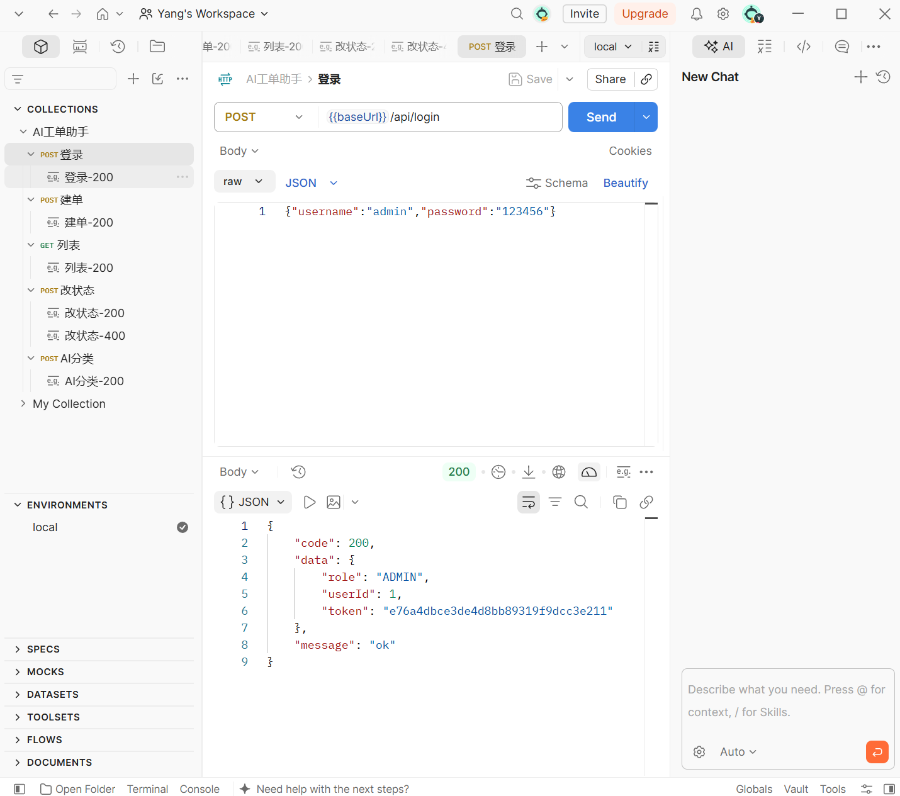
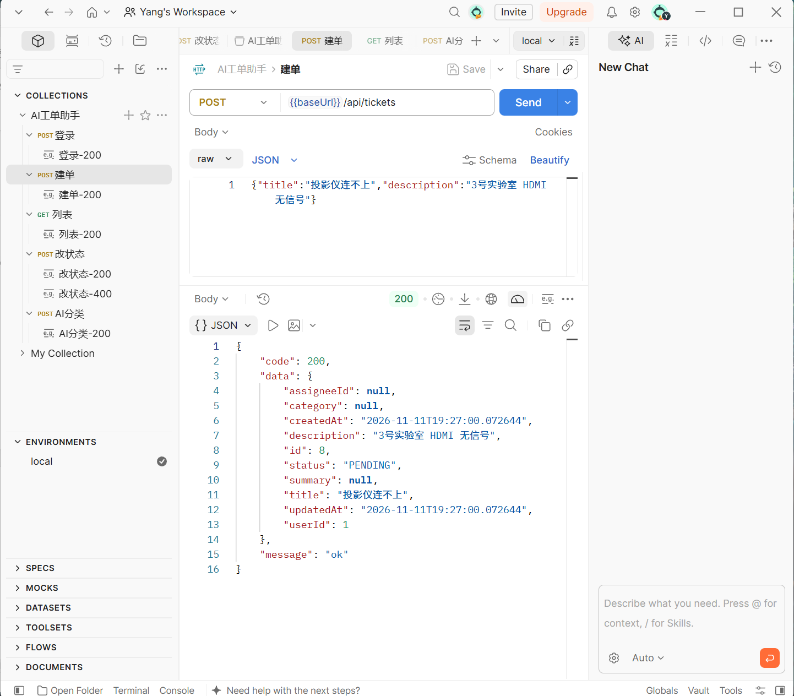
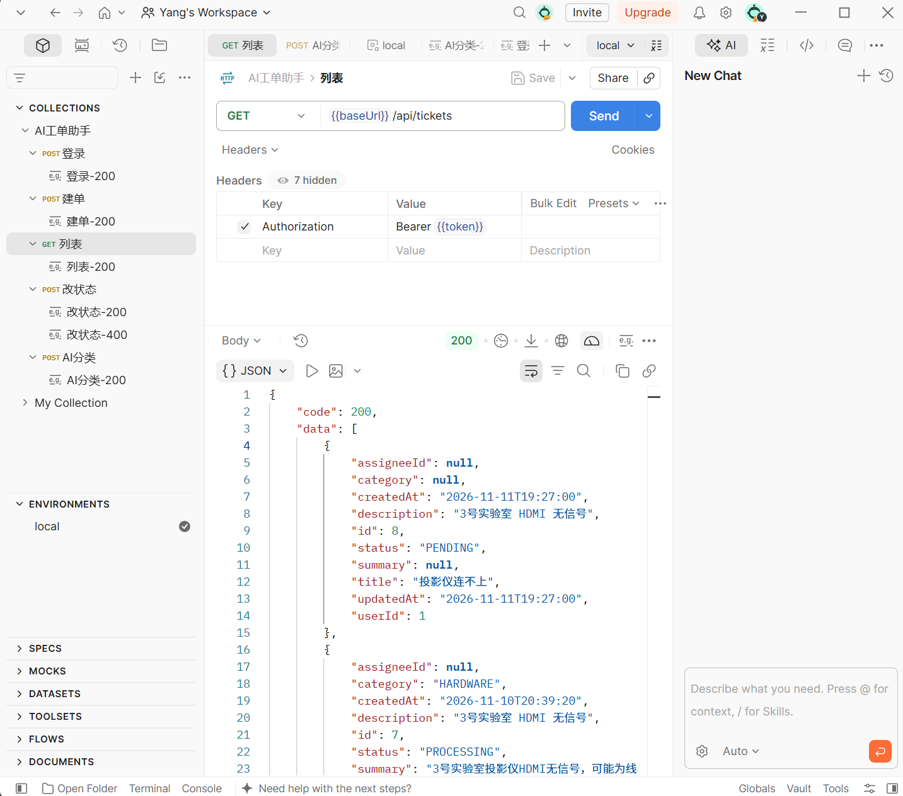
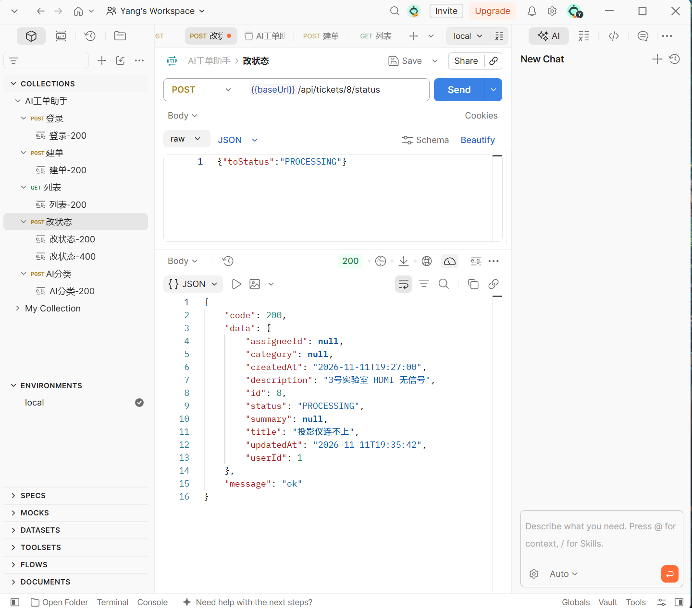
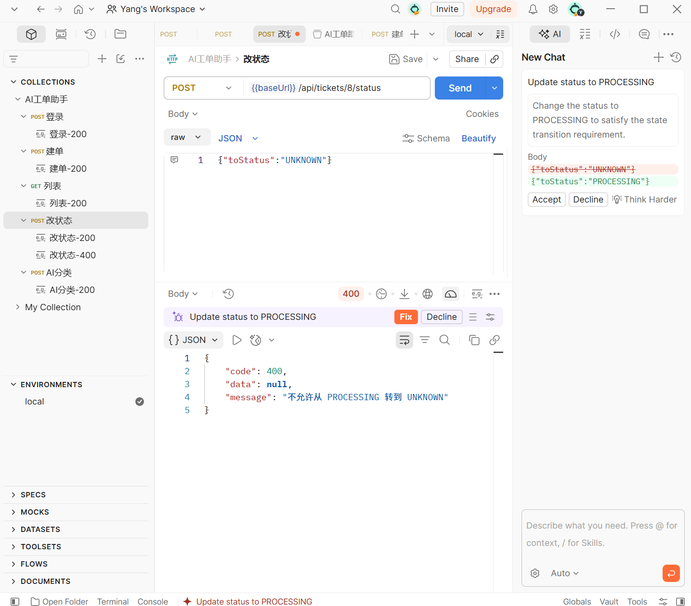
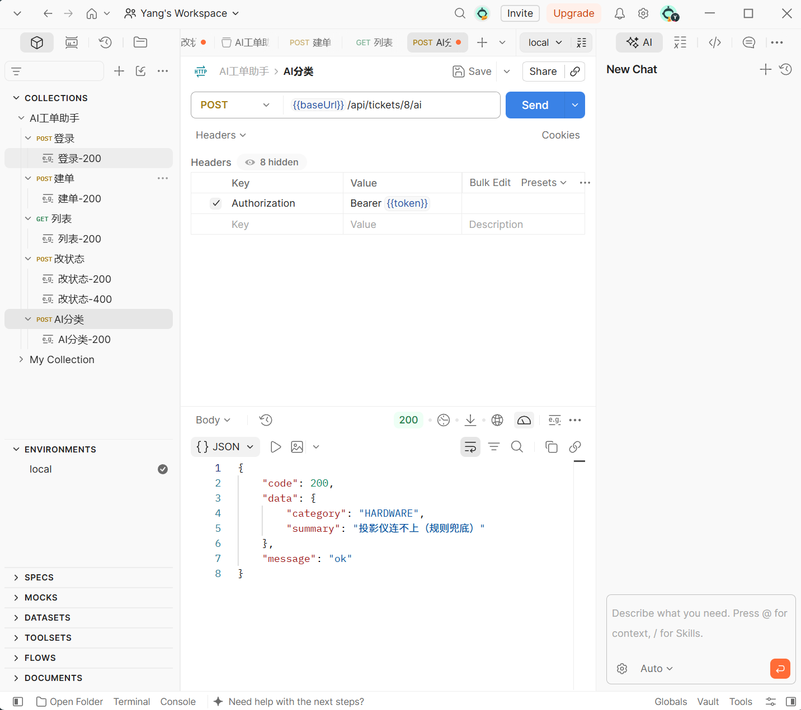

# AI 工单助手

一个面向校园设备报修场景的 Java 后端项目。系统支持用户登录、工单创建与查询、状态流转、操作日志，以及基于大语言模型的工单分类与摘要。当模型不可用或输出不合法时，系统会自动使用关键词规则完成降级分类，避免 AI 故障影响核心工单流程。

## 项目亮点

- 使用 Spring Boot 4、MyBatis-Plus 和 MySQL 实现分层后端服务。
- 使用内存 Token 完成登录鉴权，受保护接口通过 `Authorization: Bearer <token>` 访问。
- 创建工单时在同一事务中写入工单与操作日志，保证数据一致性。
- 使用状态机限制工单流转，并通过“工单 ID + 旧状态”条件更新避免并发覆盖。
- 约束大模型返回 JSON，校验分类枚举；失败后重试一次，再使用关键词规则降级。
- 使用 Postman 验证登录、建单、列表、状态变更和 AI 分类 5 个接口。

## 技术栈

| 分类 | 技术 |
| --- | --- |
| 开发语言 | Java 21 |
| Web 框架 | Spring Boot 4.0.9、Spring MVC |
| 数据访问 | MyBatis-Plus 3.5.17 |
| 数据库 | MySQL 8.x |
| AI 调用 | Spring RestClient、OpenAI 兼容接口 |
| 构建与测试 | Maven、JUnit 5、Postman |

## 请求流程

```text
Postman
   |
   v
Controller -> Service -> Mapper -> MySQL
                 |
                 +-> LLM API
                       |
                       +-> JSON 校验 / 重试 / 规则降级
```

## 数据模型

- `user`：登录用户及角色。
- `ticket`：工单标题、描述、状态、分类和摘要。
- `ticket_log`：工单创建及状态变化日志。

工单状态流转规则：

```text
PENDING -> PROCESSING -> DONE -> CLOSED
    |           |
    +-> CLOSED  +-> PENDING
```

## 接口列表

| 方法 | 地址 | 功能 | Token |
| --- | --- | --- | --- |
| POST | `/api/login` | 登录并获取 Token | 否 |
| POST | `/api/tickets` | 创建工单 | 是 |
| GET | `/api/tickets` | 查询工单，可按状态筛选 | 是 |
| POST | `/api/tickets/{id}/status` | 修改工单状态 | 是 |
| POST | `/api/tickets/{id}/ai` | AI 分类并生成摘要 | 是 |

## 本地运行

### 1. 环境要求

- JDK 21
- Maven 3.9+
- MySQL 8.x

### 2. 初始化数据库

在 MySQL Workbench 或命令行中执行 [schema.sql](docs/sql/schema.sql)。脚本会创建 `ticket_db`、3 张业务表和本地演示账号 `admin / 123456`。

该密码仅用于本地演示，不能用于生产环境。

### 3. 创建本地配置

在项目根目录执行：

```powershell
Copy-Item .\src\main\resources\application.example.yaml .\src\main\resources\application.yaml
$env:DB_USERNAME = "root"
$env:DB_PASSWORD = "你的 MySQL 密码"
```

如需调用大模型，再设置：

```powershell
$env:LLM_API_KEY = "你的 API Key"
```

不设置 `LLM_API_KEY` 时，AI 接口会自动使用关键词规则完成分类。

### 4. 启动应用

在 IDEA 中运行 `TicketDemoApplication`，或使用 Maven：

```powershell
mvn spring-boot:run
```

应用启动后访问 `http://localhost:8080/hello` 检查服务状态。

### 5. 调试接口

将 [Postman Collection](docs/postman/ai-ticket-assistant.postman_collection.json) 导入 Postman，按编号依次运行请求。登录和建单请求会自动保存 `token` 与 `ticketId`。

## 接口演示

### 登录



### 创建工单



### 查询工单



### 状态流转





### AI 分类与摘要



## 项目结构

```text
src/main/java/com/example/ticketdemo
|-- common       # 统一响应与异常处理
|-- controller   # HTTP 接口
|-- entity       # 数据库实体与 AI 结果对象
|-- mapper       # MyBatis-Plus 数据访问层
`-- service      # 登录、工单、Token 与 AI 业务逻辑

docs
|-- postman      # Collection 与接口截图
`-- sql          # 数据库初始化脚本
```

## 当前边界与后续计划

当前版本以完整演示核心流程为目标：Token 保存在内存中，服务重启后失效；演示账号使用明文密码；自动化测试暂时只覆盖应用上下文启动。

后续计划：

- 使用 BCrypt 保存密码，并使用 Spring Security 和 JWT 完善鉴权。
- 增加 DTO、参数校验、分页查询和角色权限控制。
- 增加工单分配功能及核心业务的自动化测试。
- 使用 Docker Compose 简化应用与数据库部署。

## 安全说明

- `application.yaml`、`.env`、数据库密码和 API Key 不得提交到仓库。
- 公开仓库只提供 `application.example.yaml`，敏感值通过环境变量注入。
- 若 Key 曾被提交到远程仓库，应立即在服务商后台撤销并重新生成。

